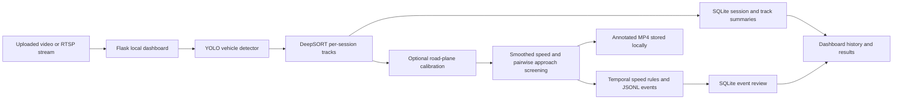

# SAFE-Drive Project Report

**Project:** SAFE-Drive Research Toolkit
**Repository:** [github.com/bhuvzzs24-spec/SAFE-Drive](https://github.com/bhuvzzs24-spec/SAFE-Drive)
**Report date:** 27 October 2026
**Status:** Research prototype; not validated for operational enforcement

## Executive summary

SAFE-Drive is a local traffic-video analysis prototype intended to support research into calibrated vehicle motion and near-miss screening. This iteration turns the original collection of scripts into a more reproducible toolkit and adds a local web dashboard for submitting an offline video or connecting to an RTSP/RTSPS IP camera with camera calibration, following job status, and reviewing annotated output and approach-risk events.

The current implementation is deliberately narrower than a full automated enforcement system. It detects general vehicle classes, associates detections across frames, maps vehicle contact points to a metric road plane, estimates motion, screens vehicle pairs for a close future approach, and records reviewable events. It does not include a trained helmet model, plate OCR, behavioral intervention, fine generation, or validated performance results.

## Problem and motivation

Traffic video can support retrospective analysis of vehicle movement and conflicts, but image-space box overlap and arbitrary pixel-to-distance conversion are weak foundations for quantitative claims. Camera geometry, tracking stability, motion estimates, and event definitions all affect results. SAFE-Drive therefore makes calibration inputs, quality states, risk components, and evaluation requirements visible rather than presenting unverified outputs as authoritative.

## Current system

### Processing path

1. The operator selects an offline video or bounded RTSP/RTSPS camera session, plus site calibration and detector weights, in the local dashboard.
2. A YOLO detector produces vehicle detections; DeepSORT associates detections into temporary clip-level tracks.
3. The bottom-centre of each tracked box is projected into road-plane coordinates using a homography fitted from pixel/metre correspondences.
4. A timestamp-aware estimator computes metric speed after a minimum observation baseline.
5. Pairwise track positions and velocities feed a constant-velocity closest-approach and TTC screen.
6. Elevated and high screening events are annotated in the output clip and appended to JSONL with review metadata.
7. The dashboard presents the annotated video and a readable event list.

The dashboard stores uploaded clips, calibration files, and outputs locally under `local_data/`; that path is git-ignored. Sessions, per-track summaries, events and reviewer decisions persist in SQLite. A live camera address is passed to the worker for the session and omitted from event records and error logs. The web server binds to loopback. Live job progress is in memory and resets on restart.

### Repository components

| Component | Purpose |
| --- | --- |
| `app.py`, `templates/`, `static/` | Offline video and RTSP camera analysis, job status, annotated video, and event review interface |
| `src/safe_drive/geometry.py` | Pixel-to-road-plane homography and contact-point projection |
| `src/safe_drive/speed.py` | Timestamp-aware metric motion estimate and warm-up status |
| `src/safe_drive/encounters.py` | Pairwise closest approach, closing speed, TTC, and screening level |
| `src/safe_drive/risk.py` | Transparent advisory score with explicit missing-signal fields |
| `src/safe_drive/events.py` | Append-only JSONL event writer and content-addressed event ID |
| `src/safe_drive/cli.py` | Optional video-file and RTSP detector/tracker processing path |
| `src/safe_drive/camera_input.py` | Demo/video/webcam/RTSP configuration normalization and explicit fallback state |
| `src/safe_drive/tracking.py` | Independent per-track measurements, trajectory history, and expiration |
| `src/safe_drive/rules.py` | Time-confirmed configured speed-limit events and per-track cooldown |
| `src/safe_drive/storage.py` | SQLite camera/session/track/event schema and reviewer decisions |
| `config/calibration.example.json` | Example calibration file structure; values are placeholders only |
| `docs/RESEARCH_PLAN.md` | Proposed research question, split plan, baselines, and metrics |
| `legacy/` | Unmodified starter scripts retained for comparison, with known limitations documented |

## User interface

The interface is a dark, responsive research console with source selection, original-video preview, calibration and detector selection, optional speed policy, queued/running/completed/failed status, stop control, live track/event updates, original versus annotated playback, vehicle-track table, and persistent human review actions. It emphasizes local processing and human review. The dashboard is a local research tool, not a multi-user hosted product; it has no account system, durable job database, ONVIF discovery, or production deployment setup.

## Research direction

A suitable initial paper question is: **How reliably can calibrated monocular trajectories screen for vehicle-pair near-miss events across camera sites and lighting conditions, and how does uncertainty-aware speed gating affect false alerts?**

The contribution should be judged against a current literature review rather than inferred from combining feature names. The project report and research plan define a testable path: collect authorized multi-site clips, annotate conflict events under a written operational definition, obtain independent speed ground truth, split by site/session, compare image-space and calibrated baselines, report event-level precision/recall and false alerts per camera-hour, and include subgroup and failure analysis.

## Limitations and risks

- Calibration accuracy depends on measured correspondences, fixed-camera geometry, and the represented road plane. The example calibration points must never be used for real measurement.
- The detector and tracker can fail under occlusion, low light, rain, camera motion, crowded traffic, or domain shift.
- Constant-velocity TTC is a screening approximation and does not model turning, road topology, vehicle dimensions, or uncertainty propagation.
- Speed estimates are not validated against radar or surveyed ground truth in this repository.
- The currently used risk thresholds are illustrative and are not probabilities, legal standards, or fines.
- There is no supplied dataset, trained helmet detector, human-subject outcome study, benchmark table, or model card.
- Transient dashboard job state is memory-only; persisted SQLite session, track, event and review records remain after restart, while interrupted jobs must be resubmitted.
- Live-camera support requires a reachable RTSP/RTSPS endpoint and compatible local OpenCV transport/codec support; camera discovery and automatic reconnect are not implemented.
- Frames are processed sequentially, with no guaranteed real-time throughput or annotated live preview; the recording is available after the session ends or is stopped.
- No accuracy, safety benefit, novelty, or publication acceptance claim is established.

## Responsible use

Use only footage with appropriate permission. Keep source footage and generated results local, minimize retention, and redact identifying content before sharing. Treat track IDs as temporary technical labels. Require human review for all events. Do not use these outputs to issue penalties or make decisions about individuals.

## Next milestones

1. Add a versioned calibration workflow with reprojection residuals and an independent calibration check.
2. Add uncertainty estimates and temporal filtering, then quantify their effect using ablations.
3. Define and annotate a multi-site evaluation set with independent speed ground truth and inter-rater review.
4. Compare against overlap, image-space TTC, calibrated TTC, and appropriate public benchmarks.
5. Report confidence intervals, camera/site subgroup results, false-alert rates, failure cases, and hardware latency.
6. Only after evaluation, decide whether helmet compliance is a defensible extension and train/evaluate a dedicated model.

## Reproducibility and execution

Install with `python -m pip install -e '.[vision]'`, create a site-specific calibration file, then launch `python app.py` and open `http://127.0.0.1:5170`. The pretrained detector weights may be downloaded on first use; record the precise weight file, its hash, library versions, calibration file, and full run settings for every experiment. The app installs Flask as a base dependency so the dashboard is available with the standard project install. This iteration adds optional calibration, per-track summaries/trails, configured temporal speed events, SQLite persistence and review, plus RTSP sessions. It does not claim benchmark validation. Live camera mode connects to a stream; it does not install the application into camera firmware.
